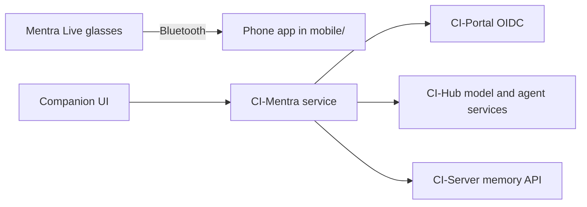

<h1 align="center">CI-Mentra</h1>

<p align="center"><strong>Mentra Glass Live App</strong></p>

[](https://github.com/companionintelligence/CI-Mentra/tags)
[](https://github.com/companionintelligence/CI-Mentra)
[](LICENSE.md)
[](https://discord.com/invite/yQp9hwpzAa)

<p align="center"><a href="https://mentra.ci.computer">Website</a> · <a href="#ollama-over-tailscale">Get started</a> · <a href="https://docs.ci.computer/docs/reference/open-source-systems">Systems map</a> · <a href="https://docs.ci.computer/docs/apps-available/first-party-apps/mentra-live">Documentation</a></p>

<p align="center">
  <a href="https://mentra.ci.computer"></a>
</p>


## Features

| Feature | What it provides |
|---|---|
| **Identity** | Sign in with CI Portal OIDC in the hosted runtime. |
| **Inference and agents** | Use configured Hub inference and Hermes/OpenClaw endpoints. |
| **Memory** | Send and retrieve data through the user-configured Companion Memory API. |
| **Companion UI** | A companion UI at `/` and its `/api/companion` API, guarded by the façade's credentials. |
| **Phone app** | iOS and Android companion for Mentra Live, built on the Mentra Bluetooth SDK, in [`mobile/`](mobile/README.md). |

## Mobile app (iOS and Android)

The phone app for Mentra Live glasses lives in [`mobile/`](mobile/README.md). It is
an Expo app built on the
[Mentra Bluetooth SDK](https://docs.mentraglass.com/bluetooth-sdk/overview), which
connects the phone straight to the glasses over Bluetooth. The app scans for
glasses, connects, shows device status and button or touch events, and sends text
to glasses that have a display. With CI-Portal sign-in and **Capture to memory** on,
it also sends what the wearer says (final transcripts), button and touch events, and
battery changes to your appliance's memory. It can ask the agent a question and take a
photo on request. Raw audio is not uploaded. See
[the phone app's companion section](mobile/README.md#companion-sign-in-memory-and-the-agent).

```bash
cd mobile
npm ci
npx expo prebuild --platform ios      # or --platform android
npx expo run:ios                      # needs Xcode and CocoaPods
npx expo run:android                  # needs JDK 17 or newer and the Android SDK
```

Simulators can't scan for Bluetooth devices, so a real connection needs a physical
phone and supported glasses. See [`mobile/README.md`](mobile/README.md) for
permissions, signing and the release checklist.

## Runtime

The service runs on either [Deno](https://deno.com) (2.9+, preferred; used by
the Dockerfile) or Node.js 20+. Source is real ESM (`"type": "module"` +
`module: NodeNext` + `verbatimModuleSyntax` in `tsconfig.json`): relative
imports carry explicit `.ts` extensions and type-only imports are marked
`type`, so the same files run unbundled under Deno and Node's type stripping.
Deno resolves npm dependencies directly via `deno.json`'s `nodeModulesDir: "auto"`.

```bash
# Deno
deno task dev     # deno run -A --watch src/index.ts
deno task test    # runs the Jest suite (see "Testing" note below)
deno task build   # deno check src/index.ts (type-check)
deno task lint

# Node (unchanged)
npm install
npm run dev       # node --watch --experimental-strip-types src/index.ts (Node 22.6+)
npm test          # jest
npm run build     # tsc -> dist/ (plus dist/store/schema.sql)
npm start         # node dist/index.js
```

**Testing note:** the existing test suite uses `jest.mock()` for module
mocking, which Deno's test runner has no equivalent for (Deno's ES module
records are immutable, so modules can't be monkey-patched the way Jest does).
Plain `deno test` therefore can't run these specs, so `deno task test`
delegates to Jest (`npm test`), which is the supported way to run the suite.

## Companion Intelligence integration

> **The glasses run on the phone app.** This service no longer runs a Mentra cloud
> bridge. The cloud SDK it was built on (`@mentra/sdk`) has produced no sessions since
> MentraOS 3.0 in August 2026, so the bridge, its voice loop and the MentraOS manifest
> were removed. The phone app in [`mobile/`](mobile/README.md) is the path for glasses.
> Companion Hub, Companion Memory and sign-in integrations stay in this service.

CI-Mentra exposes an OpenAI-compatible façade (`/v1/*`) and the Companion API for the
CI platform. It integrates with the CI platform in four ways.

### 1. Login via CI-Portal OIDC (SSO)

CI-Portal is the platform IdP (better-auth, EdDSA). CI-Mentra supports **both**
OIDC patterns; they can be enabled independently.

**A. Resource server — validate a presented token.** Set `PORTAL_OIDC_ENABLED=true`
to accept a **CI-Portal JWT** in `Authorization: Bearer …`, validated via Portal's
JWKS with `iss`/`aud`/`exp` checks (mirrors CI-Server's `PortalTokenService`).

| Var | Meaning | Default |
|-----|---------|---------|
| `PORTAL_OIDC_ENABLED` | Accept Portal OIDC bearer tokens | `false` |
| `PORTAL_OIDC_ISSUER` | Expected `iss` — the **bare origin**, no `/api/auth` | `https://hub.companionintelligence.com` |
| `PORTAL_OIDC_JWKS_URI` | Portal JWKS endpoint | `<origin>/api/auth/jwks` |
| `PORTAL_OIDC_AUDIENCE` | Comma-separated allowlist of accepted `aud` (client ids) | `ci-mentra,ci-import-tools,ci-server,ci-hub` |

**B. Interactive login — Authorization Code + PKCE (like CI-Import-Tools).** Set
`MENTRA_OIDC_ENABLED=true` to expose a browser sign-in flow under `/api/auth`:

| Route | Purpose |
|-------|---------|
| `GET /api/auth/config` | Whether login is enabled + where to start it |
| `GET /api/auth/login` | Begins PKCE; 302 → CI-Portal authorize |
| `GET /api/auth/callback` | Exchanges the code, verifies the id_token, sets a session |
| `GET /api/auth/me` | The signed-in user (or 401) |
| `ALL /api/auth/logout` | Ends the session; RP-initiated logout if supported |

The flow is discovery-driven (no hardcoded endpoints), verifies the `id_token`
signature + `nonce`, and keeps all tokens **server-side** — the browser only holds
the signed `mentra_session` cookie, which the façade also accepts as a credential.

| Var | Meaning | Default |
|-----|---------|---------|
| `MENTRA_OIDC_ENABLED` | Enable the interactive login flow | `false` |
| `MENTRA_OIDC_ISSUER` | Discovery base URL (**includes** `/api/auth`) | `https://hub.companionintelligence.com/api/auth` |
| `MENTRA_OIDC_CLIENT_ID` | Registered public PKCE client | `ci-mentra` |
| `MENTRA_OIDC_SCOPES` | Requested scopes | `openid profile email offline_access` |
| `MENTRA_OIDC_REDIRECT_URI` | Override; else `${proto}://${host}/api/auth/callback` | _(derived)_ |
| `MENTRA_SESSION_SECRET` | Signs session/tx cookies (set in prod) | _(random per boot)_ |

> A dedicated `ci-mentra` client should be registered in CI-Portal (its
> `/api/auth/oauth2/register` endpoint exists). Until then, set
> `MENTRA_OIDC_CLIENT_ID=ci-import-tools` — a registered public client that
> allows localhost redirects — to run the flow. `GET /health` reports the active
> auth mode and whether interactive login is enabled.

The static `FACADE_API_KEY` remains a service-client fallback in all cases.

### 2. Standardized Ollama connection (CI-Hub instance)

The Ollama base URL resolves in this order: `OLLAMA_BASE_URL` → `OLLAMA_HOST` →
`LLM_API_BASE` (any trailing `/v1` is stripped) → `http://localhost:11434`. This
accepts both this repo's original var and the CI-Hub / CI-Server conventions, so
the same env works locally and inside a Hub-managed container (where the Hub
injects `http://host.docker.internal:11434`). A non-empty bearer (`OLLAMA_API_KEY`,
default `ollama`) is always sent, matching the appliance convention. The default
chat model comes from `LLM_DEFAULT_CHAT_MODEL`.

### 3. Backend hermes / openclaw server on CI-Hub

The CI-Hub does not proxy inference; it hands each marketplace app an
OpenAI-compatible endpoint. CI-Mentra exposes a **`hermes` provider** for that
backend. Configure it directly with `HERMES_OPENAI_BASE_URL` /
`HERMES_OPENAI_API_KEY` / `HERMES_DEFAULT_MODEL`, or set
`HUB_INFERENCE_BOOTSTRAP=true` to auto-discover credentials at startup from
`GET ${hub}/api/inference/apps/${HUB_APP_SLUG}/bootstrap.env` (fail-open).
Route a request to it by setting `DEFAULT_PROVIDER=hermes`, or per-request with a
`hermes:` / `openclaw:` model prefix (e.g. `hermes:gemma4:latest`).

| Var | Meaning | Default |
|-----|---------|---------|
| `CI_HUB_URL` | Hub origin; falls back to the Hub-injected `HUB_URL` | `http://ci-hub:5002` |
| `HUB_APP_SLUG` | Which app's handout to fetch | `ci-mentra` |

The Hub answers `bootstrap.env` **only to a container it installed under that
slug's app name** (its `AppContainerOriginGuard`), so a Hub-installed CI-Mentra
uses its own `ci-mentra` slug, which hands out `LLM_API_BASE` / `LLM_API_KEY` /
`LLM_DEFAULT_CHAT_MODEL` plus `OLLAMA_HOST`. That slug needs a CI-Hub release that
includes it; older Hubs answer 403 and CI-Mentra keeps its configured endpoints.
Production Hubs listen on `5002` (container `ci-hub`, alias `ci-os-hub`); `3000`
is only the source-dev default.

**Marketplace manifest.** The CI-Marketplace listing for `ci-mentra` should
declare the Hub integrations so the Hub injects inference and memory env at
install time, with no bootstrap call needed:

```json
"hub_integration": {
  "inference": {
    "llm_base_url": "LLM_API_BASE",
    "llm_api_key": "LLM_API_KEY",
    "chat_model": "LLM_DEFAULT_CHAT_MODEL",
    "ollama_host": "OLLAMA_HOST"
  },
  "memory": { "url_env": "CI_SERVER_URL", "token_env": "CI_SERVER_TOKEN", "url_style": "origin" }
}
```

With the memory mapping, the Hub's connect flow mints a **memory-scoped**
CI-Server key for `ci-mentra` (CI-Server's `ConnectService` scopes it to
`memory`) and injects it as `CI_SERVER_TOKEN`, which §4 already reads. With
`url_style: origin`, set `CI_SERVER_MEMORY_PATH_PREFIX` to match what that origin
serves (see §4).

### 4. Companion Memory (CI-Server)

This is what makes the companion answer *as your companion* rather than as a generic
chatbot: CI-Server is the memory brain, and CI-Mentra reads and writes it on every
request — the same integration the Hermes / OpenClaw plugins use.

| Var | Meaning | Default |
|-----|---------|---------|
| `MENTRA_MEMORY_ENABLED` | Enable Companion Memory | `false` |
| `CI_SERVER_URL` | CI-Server origin | `http://ci-server:8642` |
| `CI_SERVER_MEMORY_PATH_PREFIX` | Path prefix in front of `/memory/*` (see below) | `/api` |
| `CI_SERVER_MEMORY_KEY` | Memory-scoped CI-Server API key (falls back to `CI_SERVER_TOKEN`) | _(empty)_ |
| `MENTRA_MEMORY_PLATFORM` | Tags memories/turns written by this device | `mentra` |
| `MENTRA_MEMORY_RECALL_MAX` | Recall hits pulled into the prompt per request (clamped to CI-Server's 1–20) | `6` |

> **The memory API is _not_ Portal-OIDC authenticated.** CI-Server's `/memory/*`
> routes are `ApiKeyGuard`-only and expect an **`x-api-key`** header carrying a
> **memory-scoped CI-Server API key** — *not* a CI-Portal bearer token. Issue one
> from CI-Server exactly as you would for the Hermes/OpenClaw `CI_SERVER_TOKEN`.
> Portal OIDC (§1) authenticates the *wearer* to CI-Mentra; this key authenticates
> *CI-Mentra* to CI-Server. They are separate credentials.

> **`CI_SERVER_MEMORY_PATH_PREFIX` depends on what `CI_SERVER_URL` points at.**
> CI-Server's NestJS app has no `/api` prefix of its own — its `MemoryController`
> mounts bare at `/memory`. The `/api` prefix exists only on the gateway/reverse-proxy
> in front of it. So: pointed at the gateway or a Hub-fronted origin (the normal
> case) → keep the default `/api`; pointed directly at the raw CI-Server API
> container, bypassing any gateway → set it to `` (empty).

The loop, per session and per request (paths shown with the default `/api` prefix):

| Call | When | Purpose |
|------|------|---------|
| `GET /api/memory/context` | Once per session (cached 10 min) | L0 profile block prepended to the system prompt |
| `POST /api/memory/recall` | Every request | Hybrid pgvector RAG; returns a prompt block of relevant memories |
| `POST /api/memory/turn` | After every exchange | Persists the turn (idempotent server-side) |
| `POST /api/memory/write` | On "remember this…" | Stores a durable memory fragment |

Response parsing is tolerant of minor CI-Server surface drift: it reads `block`,
falling back to `context`, falling back to joining `results[].text/content/summary`.

`MENTRA_MEMORY_ENABLED=true` **and** a non-empty key are both required — either
missing and memory stays off. **Every call is fail-open:** if CI-Server is
unreachable, slow, or erroring, the assistant still answers, just without memory
(context/recall degrade to empty blocks, writes are dropped with a log line). The
glasses never go silent because the memory brain is down. `GET /health` reports
`memory.enabled` so you can tell "off" from "misconfigured".

### 5. Assistant persona + short-term memory

Long-term memory (§4) is CI-Server's job; **short-term memory is local** — a rolling
in-process window of the last N exchanges per session, which is what keeps follow-ups
("what about tomorrow?") coherent.

| Var | Meaning | Default |
|-----|---------|---------|
| `MENTRA_PERSONA` | System prompt for the companion | _(warm, concise glasses assistant; 1–3 sentence replies)_ |
| `MENTRA_LANGUAGE` | Assistant language tag | `en-US` |
| `MENTRA_MAX_HISTORY_TURNS` | Rolling in-session window, in exchanges | `8` |

The composed system prompt is `persona` + profile context + recall block. Keep the
persona's replies short.

## Companion UI

A static app served at the **site root** (`/`) of the façade port — one build that
works from a phone and from an R1 ring. It talks only to the Companion BFF below, so
it holds no credentials: the `mentra_session` cookie from §1B is the whole story. If
you are not signed in it shows a login gate pointing at `/api/auth/login`.

**Ring key map.** The R1 has no pointer, so the UI is a focus-ring app: everything is
reachable by arrow keys and confirmed with one button.

| Input | Action |
|-------|--------|
| `ArrowUp` / `ArrowDown` | Move focus between controls |
| `ArrowLeft` / `ArrowRight` | Move focus within a row / scrub a list |
| `Enter` or `Space` (tap) | Activate the focused control |
| `Space` (hold) | Push-to-talk — records while held, sends on release |
| `Escape` | Dismiss / back out to the previous view |

Touch works the same way on a phone; no key map required.

### Companion BFF API

Mounted at `/api/companion`, JSON in / JSON out, guarded by the same credentials as
the façade (OIDC session cookie, Portal bearer, or `FACADE_API_KEY`).

| Route | Purpose |
|-------|---------|
| `GET /api/companion/status` | Auth state, user, memory/provider/model, `loginUrl` — **200 even when signed out**, so the UI can render the login gate |
| `POST /api/companion/ask` | The main loop: recall → answer → persist the turn |
| `POST /api/companion/memory/search` | Query long-term memory directly (`/api/memory/recall` passthrough) |
| `POST /api/companion/memory/remember` | Save a durable memory fragment |
| `GET /api/companion/profile` | The L0 profile/context block for this wearer |
| `GET /api/companion/history` | The rolling short-term history for a `sessionId` |
| `POST /api/companion/capture` | Store a batch of glasses records (speech, input, device, photo) as memory fragments. The reply lists the ids saved and the ids that failed |
| `POST /api/companion/capture/photo` | Store a photo the glasses upload as multipart `photo`, under `COMPANION_PHOTO_DIR`, and note it in memory |

`GET /health` reports `companionUi.path` and `companionUi.devAnonymous`.

### Dev-only: anonymous access

`MENTRA_DEV_ALLOW_ANONYMOUS=true` lets the companion UI and BFF work with no login —
useful for iterating on the UI before a `ci-mentra` client is registered in CI-Portal.

> ⚠️ **Never enable this in production.** It exposes `/api/companion` — and therefore
> the wearer's memory — to any unauthenticated caller that can reach the port.

## Hosted setup + demo: mentra.ci.computer

`site/` is a Cloudflare Worker with static assets that serves:

| Path | What |
|------|------|
| `/` | Legacy setup page for the retired Cloud SDK bridge, kept for reference. It builds a `.env` **in the browser** (nothing is sent anywhere) and can check a server's `/health` |
| `/app/` | The companion UI from `public/`, copied verbatim, running against a canned **demo BFF** (`site/src/demo.ts`). It stores nothing and never proxies to a real server |
| `/api/*` | That demo BFF |
| `/healthz` | Site liveness |

```bash
npm run site:build    # assemble site/dist (site/public + public/ as /app), then the steps below
npm run site:dev      # wrangler dev on :8787
npm run site:deploy   # wrangler deploy to mentra.ci.computer (custom domain route)
npx jest site/src     # worker, demo BFF, env-builder and built-output tests
```

`scripts/build-site.sh` copies the files into `site/dist` and then runs, in order (each is
idempotent, and the output is byte-identical on a rebuild):

| Step | What it adds |
|------|--------------|
| `scripts/inject-crosslinks.mjs` | `/app/` only: the "Demo: canned answers" strip, a footer with Companion Intelligence, Docs, **Buy Companion Core** and **Download Companion** (plus a line saying those two are for the Companion platform, not the preview), and a "Back to setup guide" link in place of the demo's Sign out. `public/index.html` itself stays the companion UI, untouched |
| `scripts/inject-ga.mjs` | GA4 on every page when the `GA_MEASUREMENT_ID` repo variable is a valid `G-XXXX` id (no inline script: `/ga-init.js`), and reveals the footer's "uses Google Analytics" line |
| `scripts/inject-seo.mjs` | `<title>`, canonical, description, icons, Open Graph/Twitter, JSON-LD, `sitemap.xml` (with `lastmod` from the newest git commit to any file that makes up the page), `robots.txt` |
| `scripts/version-assets.mjs` | `?v=<hash>` on local CSS/JS, which the Worker serves as `immutable` |

The raster icons in `site/public/` come from `site/public/icon.svg` via `scripts/make-icons.sh`,
and the 1200x630 share image `site/public/og.png` comes from `site/seo/og.svg` via
`scripts/make-og.sh`. Both need `rsvg-convert` and ImageMagick (`brew install librsvg imagemagick`),
and both outputs are committed, not built: edit the SVG, run the script, commit the SVG and the PNG.

The pages link to <https://ci.computer>, <https://ci.computer/core> (Buy Companion Core),
<https://ci.computer/download> (Download Companion) and the
[Mentra Live docs](https://docs.ci.computer/docs/apps-available/first-party-apps/mentra-live).
Companion for Mentra is a **developer preview** that cannot be installed yet, so the site says
so and does not word those buttons as if the Mentra app can be bought or downloaded.
`site/src/headers.ts` holds the CSP: no inline script or style, and the Cloudflare Web Analytics
beacon host is allowed because Cloudflare injects it.

`.github/workflows/deploy-site.yml` deploys on pushes to `main` that touch `site/`, `public/`,
`scripts/build-site.sh`, `scripts/inject-*.mjs`, `scripts/version-assets.mjs`,
`scripts/vendor-brand.sh` or the workflow file itself, and on manual dispatch. It needs the repo secrets
`CLOUDFLARE_API_TOKEN` (Workers Scripts: Edit, plus Workers Routes: Edit on the
`ci.computer` zone) and `CLOUDFLARE_ACCOUNT_ID`, set on the `production` environment.

**Health check.** The legacy setup page reads `GET /health` on your server from the
browser. The server allows that cross-origin read only for `MENTRA_SETUP_ORIGINS`
(default `https://mentra.ci.computer`; empty disables it). It answers Chrome's
Private Network Access preflight too, so `http://localhost:8080` works. Only
`/health` gets the header; the cookie-authenticated `/api/*` surface stays
same-origin.

## Container image

`docker compose up -d --build` builds a `denoland/deno:alpine` image that runs
`src/index.ts` directly. `deno check` runs at build time as the type-check
gate, and the image ships `public/` (the companion UI).
It runs as the unprivileged `deno` user and has a `HEALTHCHECK` on `/health`.

On boot the service applies `src/store/schema.sql` (all `IF NOT EXISTS`) to
`DATABASE_URL`, so it works against a bare Postgres such as a Hub install, not
only the repo's compose with its initdb mount. It is fail-open: without a
database only `/v1/responses` degrades.

**Published image.** `.github/workflows/publish-image.yml` builds `linux/amd64`
and `linux/arm64` and pushes `ghcr.io/companionintelligence/ci-mentra` on `v*`
tags (as that version) and on manual dispatch (as `sha-<short>`). The run
summary prints the `tag@sha256:` reference to pin in the CI-Marketplace
`ci-mentra` listing, which stays hidden (quarantined) until that image exists.

## Ollama over Tailscale

To run the façade against an Ollama host on your tailnet, point `OLLAMA_BASE_URL` at it.
Tailscale must be running on this host so it can reach the tailnet address. No speech or
TTS endpoint is needed.

```bash
cp .env.example .env
# In .env, set:
#   DEFAULT_PROVIDER=ollama
#   OLLAMA_BASE_URL=http://<ollama-host>.<tailnet>.ts.net:11434
#   FACADE_API_KEY=<a key you choose>
docker compose up -d postgres redis
npm ci
npm run dev
```

Check that Ollama answers from this host, then check the façade:

```bash
curl -s http://<ollama-host>.<tailnet>.ts.net:11434/api/tags

curl -s http://localhost:8080/v1/chat/completions \
  -H "Authorization: Bearer <FACADE_API_KEY>" \
  -H "Content-Type: application/json" \
  -d '{"model":"llama3.2","messages":[{"role":"user","content":"Say hello."}]}'
```

<!-- companion-hub-readme-deep-review -->


## How it fits together

The glasses connect to the phone app in `mobile/`, which does not send anything to this
service yet. This service keeps identity, inference and memory as separate integrations,
and the companion UI reaches them through its BFF.



## Integration map

| Integration | Role in this setup |
|---|---|
| CI-Portal OIDC | User sign-in for the Companion Intelligence flow |
| CI-Hub Ollama | Standardized local model endpoint |
| Hermes or OpenClaw | Agent backend running on Hub |
| CI-Server / Companion Memory | Persistent memory API |
| Mentra Bluetooth SDK | Glasses connection, in the phone app (`mobile/`) only |
